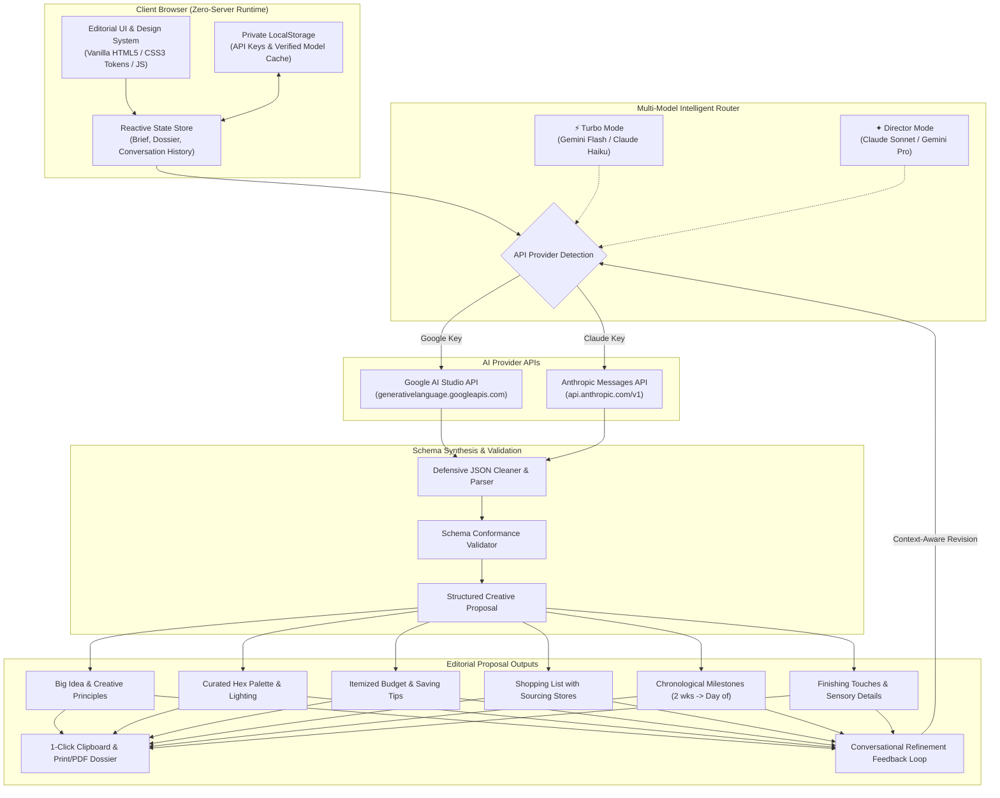

# ✦ AI Creative Director — Bespoke Experience & Creative Studio

[](https://towardsdatascience.com)
[](https://aistudio.google.com)
[](https://github.com)
[](LICENSE)

> **Transform rough, scattered ideas into magazine-grade creative concepts, atmospheric visual directions, localized itemized budgets, and step-by-step execution timelines.**

Built for **Towards Data Science ShipAI** — a working demonstration of structured multi-model generative AI, strict JSON schema synthesis, context-aware conversational refinement, and zero-server client-side privacy.

---

## ✦ Table of Contents

- [The Vision & Problem Statement](#-the-vision--problem-statement)
- [System Architecture](#-system-architecture)
- [ShipAI Stack Notes](#-shipai-stack-notes)
- [Key Features](#-key-features)
- [How It Works (Under the Hood)](#-how-it-works-under-the-hood)
- [Quick Start Guide](#-quick-start-guide)
- [Interactive Showcase / Demo Mode](#-interactive-showcase--demo-mode)
- [Prompt Engineering & Schema Specification](#-prompt-engineering--schema-specification)
- [ShipAI Video Walkthrough Blueprint](#-shipai-video-walkthrough-blueprint)
- [Security & Privacy](#-security--privacy)
- [License](#-license)

---

## ✦ The Vision & Problem Statement

Planning an event, photoshoot, salon dinner, or creative project is notoriously difficult:
1. **The Creative Gap**: People have a vague feeling or aesthetic aspiration (*"I want an intimate birthday dinner, warm candles, not cheesy at all, budget around ₦80,000"*), but lack the vocabulary of lighting, palettes, textures, and sensory design needed to translate it into reality.
2. **The Budget Disconnect**: Generic AI chatbots output high-level fluff without realistic, localized pricing, specific market recommendations, or actionable itemization.
3. **The Execution Void**: Moodboards look pretty on Pinterest, but fail to provide a step-by-step checklist of what to buy, where to source it, and when to execute.

**AI Creative Director** bridges this gap. It acts as an elite creative director, spatial designer, and financial producer in your browser—generating comprehensive, culture-aware creative dossiers calibrated to your exact stated budget and vision.

---

## ✦ System Architecture



---

## ✦ ShipAI Stack Notes

In alignment with **Towards Data Science ShipAI** standards, here is the technical breakdown of the stack:

| Component | Technology | Rationale |
| :--- | :--- | :--- |
| **Primary AI Models** | **Google Gemini** (`gemini-2.5-flash`, `gemini-2.0-flash`, `gemini-1.5-flash`)<br>**Anthropic Claude** (`claude-3-5-sonnet`, `claude-3-7-sonnet`, `claude-3-5-haiku`) | Dual-provider support ensures 100% uptime, free tier access via Google AI Studio, and top-tier reasoning via Claude Sonnet. |
| **Model Fallback Engine** | Dynamic API model discovery (`/v1/models`) + cached verified model resolver | Automatically discovers active models on the user's specific tier; automatically bypasses retired model names. |
| **Output Structure** | Zero-markdown strict JSON schema extraction | Eliminates hallucinations, parsing errors, or broken markdown blocks. |
| **Architecture** | 100% Client-Side Single Page Application (SPA) | Zero middleman server. Direct browser-to-API communication via authenticated HTTPS requests. |
| **Local Serving** | Lightweight PowerShell Native HTTP Server (`server.ps1`) | Runs out-of-the-box on any Windows machine with zero dependencies or installs. Compatible with Python/Node. |
| **Design System** | Bespoke Vanilla CSS Design System with CSS Custom Properties | Editorial luxury aesthetic: Cormorant Garamond, Playfair Display, Plus Jakarta Sans, Warm Parchment (`#F7F2EA`), Antique Gold (`#B8860B`), Deep Espresso (`#1C1815`). |
| **Privacy & Security** | Private Client-Side Key Storage in `localStorage` | API keys never touch any intermediary backend; requests originate directly from the user's browser. |

---

## ✦ Key Features

### 1. Bespoke Brief Builder & Decomposition
- Translates vague or colloquial input (*e.g. "dinner for 8 friends, African vibe, ₦80,000"*) into structured parameters: objective, currency-specific budget, visual styling, and event category.
- Pre-populated curated suggestion briefs for instant testing (Romantic Dinners, Surprise Birthdays, Brand Photoshoots, Gathering Salons).

### 2. Dual Generation Engines: Turbo vs. Director Mode
- **⚡ Turbo Mode**: Tuned for speed (3–5s latency) using Claude Haiku or Gemini Flash. Ideal for rapid brainstorming and iterative drafts.
- **✦ Director Mode**: Tuned for deep creative nuance (10–15s latency) using Claude Sonnet or Gemini Pro. Features elaborate sensory directions, poetic principles, and granular vendor breakdowns.

### 3. Culture-Aware & Localized Currency Intelligence
- Seamlessly understands and formats **Nigerian Naira (₦)**, **US Dollars ($)**, **British Pounds (£)**, and **Euros (€)**.
- References real local markets, artisanal ceramicists, and florists (e.g. Balogun Market, Lekki Arts & Crafts Market, Oyingbo Market, local botanical vendors) when given relevant regional context.

### 4. Interactive Visual Identity & Swatch System
- Live visual color palette cards rendered with computed hex swatches, role annotations (Base, Accent, Warm Glow), and click-to-view color codes.
- Specific illumination choreography: instructions on candlelight placement, lamp dimming, and eliminating harsh overhead LEDs.
- Curated moodboard search terms and aesthetic references (Kinfolk, Alára, Wabi-Sabi, Sahelian architecture).

### 5. Calculated Itemized Budget & Cost-Saving Hacks
- Transparent itemized table breaking down expenses into botanical, lighting, linen, beverages, and contingencies.
- Real creative director tips for trimming 30–50% off commercial prices (e.g. buying unbleached linen by the yard rather than designer tablecloths).

### 6. Conversational Context-Aware Refinement Loop
- Refine existing concepts dynamically without starting over.
- One-click prompt chips (*"Make it more modern"*, *"Reduce budget to ₦50,000"*, *"More colourful"*, *"Add a signature cocktail"*).
- Preserves prior creative decisions while surgically updating affected sections.

### 7. Instant Sample Concept Showcase (Zero Setup)
- Evaluators and hackathon judges can explore a fully populated, interactive creative dossier with **one click**, without needing an API key upfront.

### 8. Production Dossier & PDF Export
- Formats the proposal into an executive dossier ready for clients or vendors.
- One-click clipboard export and print/save to PDF with dedicated `@media print` typography.

---

## ✦ How It Works (Under the Hood)

1. **Brief Ingestion**:
   The user enters a description, budget, and category. The brief review phase validates all inputs and sets the model temperature ($T=0.85$).
2. **Multi-Model Routing**:
   The client detects the API key format:
   - Starts with `sk-ant-` $\rightarrow$ Routes to Anthropic API (`https://api.anthropic.com/v1/messages`).
   - Starts with `AIza` or other key $\rightarrow$ Routes to Google Generative Language API (`https://generativelanguage.googleapis.com/v1beta/models/...`).
3. **Model Fallback Chain**:
   If the preferred model is not accessible on the user's tier, the router attempts the next verified model in the priority hierarchy and caches the working model for sub-second subsequent calls.
4. **Defensive Schema Parsing**:
   The response is sanitized, stripped of markdown fences, and parsed through a bracket-delimited fallback extractor to prevent JSON truncation issues.
5. **DOM Synthesis & Animation**:
   The proposal renders with staggered CSS animation keyframes across all 8 modular sections.

---

## ✦ Quick Start Guide

### Prerequisites
- Any modern web browser (Chrome, Edge, Brave, Firefox, Safari).
- *(Optional for live AI generation)*: A free **Google Gemini API Key** from [Google AI Studio](https://aistudio.google.com/app/apikey) **or** an **Anthropic Claude API Key** from [Anthropic Console](https://console.anthropic.com/settings/keys).

### Option 1: 1-Click Launch on Windows (Recommended)
Double-click the included `Start-App.bat`:
```cmd
Start-App.bat
```
*This starts the lightweight native server (`http://localhost:8080`) and automatically opens your default browser.*

### Option 2: PowerShell
```powershell
powershell -ExecutionPolicy Bypass -File .\server.ps1
```
Then navigate to `http://localhost:8080`.

### Option 3: Python
```bash
python -m http.server 8080
```

### Option 4: Node / npx
```bash
npx serve -l 8080 .
```

### Option 5: Direct File Access
Simply double-click `index.html` in your file explorer. The entire application runs natively in your browser!

---

## ✦ Interactive Showcase / Demo Mode

Evaluating for a hackathon or ShipAI review? You don't even need an API key to experience the complete dossier:

1. Launch the app and click **✦ Explore Sample Concept** in the hero banner or brief page.
2. The app immediately renders **Nocturne & Amber: Modern Afro-Editorial Salon**, demonstrating:
   - Full 8-part creative direction dossier
   - Interactive color swatches with hex preview
   - Itemized budget table calibrated to ₦80,000
   - Sourcing shopping list and chronological timeline
   - Print-ready final proposal formatting
3. Add your free Gemini key in **Settings** (top right) whenever you want to generate bespoke concepts from your own custom prompts!

---

## ✦ Prompt Engineering & Schema Specification

The AI Creative Director operates under a system prompt designed with high-luxury editorial tone, sensory specificity, and cultural nuance:

```json
{
  "conceptName": "Distinctive evocative name (3-7 words)",
  "tagline": "A short, beautiful one-sentence summary of the concept's essence",
  "bigIdea": {
    "summary": "2-3 sentences. Core creative concept and distinctive differentiator."
  },
  "creativeDirection": {
    "vision": "2-3 sentences describing the overall vision and experience.",
    "mood": "Atmospheric tone and emotional resonance.",
    "keyPrinciples": ["Principle 1", "Principle 2", "Principle 3", "Principle 4"]
  },
  "visualIdentity": {
    "colourPalette": [
      {"name": "Colour name", "hex": "#HEXCODE", "role": "Primary/Secondary/Accent"}
    ],
    "lighting": "Detailed illumination choreography.",
    "textures": "Tactile materials, fabrics, and artisanal surfaces.",
    "styling": "Spatial layout and table arrangement.",
    "references": ["Visual Reference 1", "Visual Reference 2", "Visual Reference 3"]
  },
  "experience": {
    "description": "Sensory perspective of the guest/audience.",
    "memorableElements": ["Element 1", "Element 2", "Element 3", "Element 4"]
  },
  "budget": {
    "totalBudget": "Formatted stated budget (e.g. ₦80,000)",
    "currency": "NGN / USD / GBP / EUR",
    "items": [
      {"category": "Category", "item": "Specific item/service", "estimatedCost": "₦X,XXX", "notes": "Strategic sourcing note"}
    ],
    "totalEstimate": "₦XX,XXX",
    "savingTips": ["Strategic saving tip 1", "Strategic saving tip 2"]
  },
  "shoppingList": {
    "items": [
      {"emoji": "🛍️", "item": "Specific purchase/prep item", "where": "Sourcing store or market"}
    ]
  },
  "timeline": {
    "steps": [
      {"when": "2 weeks before", "title": "Milestone title", "description": "Actionable instructions"},
      {"when": "1 week before", "title": "Milestone title", "description": "Actionable instructions"},
      {"when": "3 days before", "title": "Milestone title", "description": "Actionable instructions"},
      {"when": "1 day before", "title": "Milestone title", "description": "Actionable instructions"},
      {"when": "Day of", "title": "Milestone title", "description": "Actionable instructions"},
      {"when": "In the moment", "title": "Milestone title", "description": "Actionable instructions"}
    ]
  },
  "finishingTouches": {
    "details": [
      "Sensory touch (scent, sound, hospitality ritual)",
      "Bespoke personal detail"
    ]
  }
}
```

---

## ✦ ShipAI Video Walkthrough Blueprint

For recording your **Towards Data Science ShipAI** video walkthrough (90s to 5 minutes, 16:9 landscape on Loom or OBS):

- **[0:00 - 0:30] Hook & Problem**:
  - Show the empty brief screen. Explain how hard it is to turn raw ideas into styled events, budgets, and execution plans.
- **[0:30 - 1:15] Live Generation**:
  - Click a sample brief (*"Intimate dinner party for 8 friends, African-inspired aesthetic, budget ₦80,000"*).
  - Walk through the Brief Review and toggle between **Turbo Mode** (Gemini Flash / Claude Haiku) and **Director Mode** (Claude Sonnet / Gemini Pro).
  - Click **Generate Creative Concept** and highlight the live step-by-step progress animation.
- **[1:15 - 2:30] The Generated Proposal**:
  - Highlight the **Big Idea** and **Creative Principles**.
  - Show the **Visual Identity** swatches (real hex previews, lighting choreography, textures).
  - Walk through the **Itemized Budget** and real market references.
  - Review the **Chronological Timeline** and **Finishing Touches**.
- **[2:30 - 3:15] Conversational Refinement**:
  - Type a refinement (*"Make it more modern and add a signature welcome cocktail"*).
  - Show how the AI maintains existing context while surgically updating the cocktail, budget, and styling.
- **[3:15 - 3:45] Technical Stack & Learnings**:
  - Briefly discuss the architecture: pure zero-server client execution, strict JSON schema synthesis, multi-model fallback routing, and zero third-party data tracking.
- **[3:45 - 4:00] Wrap-up & Call to Action**:
  - Point to the GitHub repo and invite viewers to star and try their own creative briefs.

---

## ✦ Security & Privacy

- **Zero-Server Intermediary**: Your API credentials and creative briefs are never transmitted to any third-party backend or database.
- **Direct Encrypted Calls**: All network traffic goes directly over TLS to Google or Anthropic endpoints.
- **Local Storage Isolation**: Keys remain solely in your browser's private `localStorage` and can be tested or wiped at any time via the Settings modal.

---

## ✦ License

This project is licensed under the **MIT License** — feel free to use, modify, and build upon it for commercial or personal creative projects.

---

*Crafted with precision for Towards Data Science ShipAI · AI Creative Director Studio Edition.*
